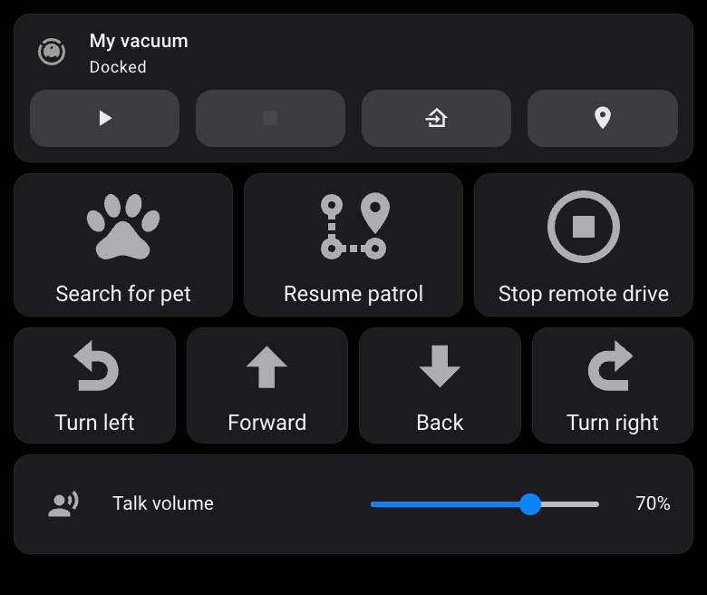

# Roborock Camera

Home Assistant custom integration that adds the camera and the camera-robot features of Roborock vacuums to the robot you already have in the core **Roborock** integration:

- **Live view** camera entity, from your go2rtc stream (RTSP).
- **Talk volume** for talking through the robot's speaker (a WebRTC card with a microphone against your go2rtc).
- Buttons: **Search for pet**, **Resume patrol**, **Stop remote drive** (ends a `move` session; to stop a pet search or patrol use the vacuum's own stop or return to dock).
- Services: `roborock_camera.move` (joystick-style), `roborock_camera.stop_moving`, `roborock_camera.patrol` (map points). They and the buttons need control permission on the vacuum.

Driving to a point is already in core: `roborock.set_vacuum_goto_position`.

Every command goes through the core vacuum entity (`vacuum.send_command`). The integration opens no cloud session of its own and needs no extra library.

## Status

Tested on a Saros 20 (`roborock.vacuum.a288`, firmware 02.57.88) with Home Assistant 2026.11.2:

| Feature | Result |
|---|---|
| Live view through go2rtc | works; H264 1600x1200 |
| Remote drive (`move`, `stop_moving`) | works |
| Search for pet | works; the robot searches the map and returns to its dock. Home Assistant shows the patrol state, not the result |
| Talk volume | works |
| Talk through the robot (go2rtc backchannel) | audio reaches the robot; not confirmed by ear |
| Patrol through map points | works; points are whole map coordinates |
| Drive to a point | core service `roborock.set_vacuum_goto_position`; works |

Other Roborock models with remote video may work; reports are welcome.

## What comes from where

This integration does not connect to Roborock itself. It adds the camera-robot features on top of two other pieces:

| Piece | Gives you | Required |
|---|---|---|
| Home Assistant's core **Roborock** integration | The Roborock account login and connection (local and cloud), the vacuum entity, start, stop, return to dock, room and zone cleaning, maps, sensors, consumables, `roborock.set_vacuum_goto_position` | Yes. Every command of this integration is sent through its vacuum entity |
| **go2rtc** that you run (standalone app or the one inside Frigate) | The live video and the talk channel, through its `roborock://` source | Only for video and talk |
| **Roborock Camera** (this repository) | Live view camera entity, Search for pet, Resume patrol, Stop remote drive, Talk volume, services `move`, `stop_moving`, `patrol` | - |
| A WebRTC dashboard card with a microphone (for example Advanced Camera Card or WebRTC Camera) | Talking through the robot's speaker | Only for talk |

Remote drive, pet search, patrol and talk volume need only the core Roborock integration and this one. Video and talk also need go2rtc.

## Requirements

- Home Assistant 2026.11 or newer.
- A Roborock vacuum with a camera and remote video (tested: Saros 20).
- go2rtc 1.9.15 and earlier use a fixed MQTT client id that Roborock's broker now refuses (`streams: wrong login`); see [go2rtc #2207](https://github.com/AlexxIT/go2rtc/issues/2207) and the fix in [go2rtc PR #2346](https://github.com/AlexxIT/go2rtc/pull/2346). Until a go2rtc release contains it, video and talk need a patched go2rtc: see [Patched go2rtc](#patched-go2rtc). Buttons and services work without it.

## Setup

### 1. Core Roborock integration

Settings > Devices & services > Add integration > **Roborock**, sign in with your Roborock account (email code). Check that the vacuum entity works (for example start and return to dock).

### 2. Remote video in the Roborock app

Only for video and talk. In the Roborock app open the robot's settings, switch on remote video and set its pattern lock. Write the pattern as digits on a 3x3 grid counted row by row from the top left:

```text
1 2 3
4 5 6
7 8 9
```

A "Z" drawn from the top left is `1235789`.

### 3. go2rtc stream

Only for video and talk. Add the robot to your go2rtc: in go2rtc's web UI use Add > Roborock and log in with the Roborock account. The generated source ends with an empty `&pin=`: fill in the pattern digits there (do not add a second `pin`). Name the stream, for example `vacuum`. In a standalone go2rtc (`go2rtc.yaml`):

```yaml
streams:
  vacuum:
    - roborock://mqtt-eu-1.roborock.com:8883?u=...&s=...&k=...&did=...&key=...&pin=1235789
```

Inside Frigate the same `streams:` block goes under `go2rtc:` in Frigate's configuration.

If go2rtc's Roborock login fails (accounts that need an email code, error 2031; see [go2rtc #2542](https://github.com/AlexxIT/go2rtc/issues/2542)), build the source from the login the core Roborock integration already holds. Copy [tools/source_from_ha.py](tools/source_from_ha.py) to the Home Assistant host and run `python3 source_from_ha.py "<vacuum name in the Roborock app>"` in a terminal (right after adding the Roborock integration, reload it once so its device cache exists); it asks for the pattern digits and prints the `roborock://` source. The output holds credentials: paste it only into your private go2rtc configuration.

The source holds your Roborock cloud credentials and the pattern: keep this configuration private. go2rtc's API shows stream sources in clear text ([go2rtc #2502](https://github.com/AlexxIT/go2rtc/issues/2502)): keep its API port private. Check the stream in go2rtc's web UI before going on.

### 4. Roborock Camera

1. Settings > **Marketplace** > **Add from link** (upper right): enter `fszalaj/roborock-camera` and select **Add**; pick type **Integration** if asked. Custom repositories need the Marketplace's GitHub connection.
2. Open **Roborock Camera**, select **Install** and restart Home Assistant.
3. Settings > Devices & services > **Add integration** > **Roborock Camera**. Pick the vacuum. For video, enter the RTSP address of the go2rtc stream from step 3 (`rtsp://` or `rtsps://`, reachable from Home Assistant, with no user, password, query or fragment), for example `rtsp://go2rtc:8554/vacuum` (inside Frigate: `rtsp://ccab4aaf-frigate:8554/vacuum`). Leave it empty if you only want the buttons and services.

Home Assistant 2026.11 replaced the separate HACS with this built-in Marketplace. Manual install instead: copy `custom_components/roborock_camera` into your Home Assistant `custom_components` folder and restart.

The new entities join the vacuum's device. The camera never pulls pictures in the background, because each pull turns the robot camera on. A dashboard card with a live view starts the camera while the view is open; keep **Preload stream** off in the camera's settings, or the robot camera runs all the time.

### 5. Talking through the robot

Use a WebRTC card with a microphone that talks to your go2rtc directly, for example Advanced Camera Card with `live_provider: go2rtc`, `go2rtc.stream` set to the stream name and `go2rtc.url` set to your go2rtc address as the browser reaches it (for example `https://go2rtc.example.lan:1984`). Browsers allow the microphone only on HTTPS pages: open Home Assistant over HTTPS, allow the microphone, and make go2rtc reachable from the browser over HTTPS/WSS (or through an authenticated same-origin proxy) and WebRTC. Behind Frigate's Home Assistant integration you can use its proxy `/api/frigate/<instance id>/mse`, which carries the stream but not go2rtc's stream list, so also set `capabilities: {force: [2-way-audio]}` on the card's camera to show the talk control. Set the speaker volume with the **Talk volume** entity.

## Patched go2rtc

[go2rtc/roborock-client-id.patch](go2rtc/roborock-client-id.patch) gives each connection a unique MQTT client id (the same change as go2rtc PR #2346). [go2rtc/build.sh](go2rtc/build.sh) clones go2rtc v1.9.15, checks its commit, applies the patch and builds a static Linux binary in Docker:

```bash
go2rtc/build.sh ./go2rtc-linux-amd64 amd64   # or arm64, arm
```

- Standalone go2rtc: run this binary in place of the released one, with the `go2rtc.yaml` from step 3.
- Frigate: Frigate runs a `go2rtc` binary placed in its configuration directory instead of its bundled one ([custom go2rtc version](https://docs.frigate.video/configuration/advanced/system/#custom-go2rtc-version)). Copy the build there as `go2rtc`, make it executable, keep the stream under `go2rtc: streams:`, restart Frigate and check its go2rtc log.

The patch only fixes the MQTT client id. It does not include the China-region login change from the same pull request. When a go2rtc release includes the fix, use that release instead.

## Remote drive

`roborock_camera.move` is a joystick-style service (no joystick card is included; the example dashboard drives with buttons): speed up to 0.3 m/s, turn in degrees, duration 100-3000 ms. Send the next move before the duration ends to keep going. Each move schedules the end of the drive session (`app_rc_end`) for its duration plus 1.5 s from the move request. `stop_moving` and **Stop remote drive** request the end at once. If the end command fails, the integration schedules another attempt 2 s later and refuses new moves until one succeeds. The robot's own stop follows that command, so keep the robot in sight while driving.

## Dashboard

Generic example with standard cards only: [examples/dashboard.yaml](examples/dashboard.yaml). Replace each `my_vacuum` entity id with the full entity id from **Settings > Devices & services > Entities**, including the ids in action data and targets.



## Privacy

The video and talk sessions are set up through the Roborock cloud; the robot may announce remote viewing. Use them only where everyone at home knows.

## License

MIT
